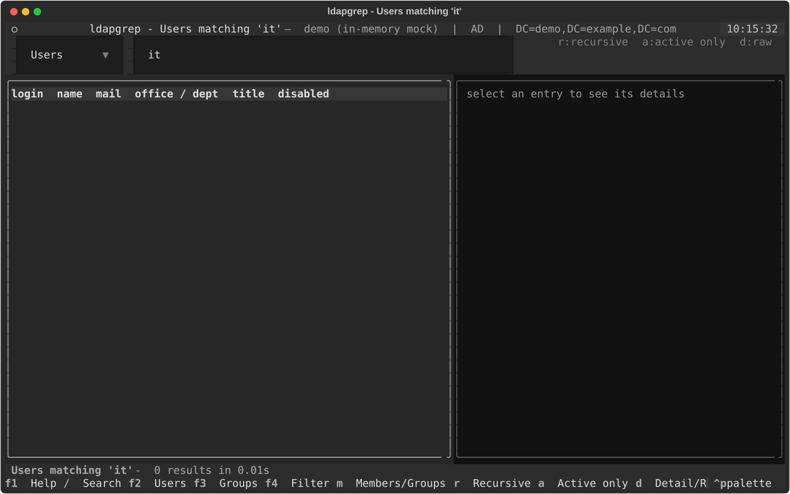

# ldapgrep

**grep your company's Active Directory / LDAP from the terminal.**
Search users and groups, resolve nested memberships, compare accounts, export to CSV / JSON / LDIF,
and browse everything in an interactive console GUI.

```
ldapgrep user "max müller" --memberof        # who is Max, and where is he a member?
ldapgrep group "IT-Admins" --recursive       # everybody in a group, nested groups resolved
ldapgrep groups "vpn*" --count-members       # which groups exist, how big are they?
ldapgrep memberof jdoe --recursive           # every group a user ends up in
ldapgrep compare jdoe asmith                 # why can Alice open the share and Bob can't?
ldapgrep tui                                 # the console GUI
```

Works with **Active Directory** (incl. Samba AD) and **generic LDAP** servers (OpenLDAP, 389ds):
the server type, base DN and available attributes are detected automatically. Attributes that
do not exist on *your* server are skipped instead of crashing the tool.

Version 2.3.1 - see [CHANGELOG.md](CHANGELOG.md).

---

**Contents**
[Quick start](#quick-start) ·
[Installation](#installation) ·
[Configuration](#configuration) ·
[Commands](#commands) ·
[Examples](#examples) ·
[Console GUI](#console-gui-ldapgrep-tui) ·
[Troubleshooting](#troubleshooting) ·
[Security](#security-notes) ·
[Robustness](#robustness-notes) ·
[Project layout](#project-layout) ·
[Development](#development)

---

## Quick start

```bash
pip install -r requirements.txt
ldapgrep config --example > ldap-grep.conf    # fill in server / bind_dn (password optional, see below)
python3 ldap-grep.py --config ldap-grep.conf check       # DNS, port, TLS, bind
python3 ldap-grep.py --config ldap-grep.conf user meier  # first real query
python3 ldap-grep.py --config ldap-grep.conf tui         # the console GUI
```

No server at hand? Every command accepts `--demo` and runs against a built-in, fictional directory:

```bash
python3 ldap-grep.py --demo user mül
python3 ldap-grep.py --demo group "All Staff" --recursive --format table
python3 ldap-grep.py --demo tui
```

## Installation

Pure Python, no C libraries (uses [`ldap3`](https://ldap3.readthedocs.io)), Python 3.9 or newer,
Linux / macOS / Windows.

```bash
pipx install "ldapgrep[tui]"               # from PyPI, isolated on your PATH -> `ldapgrep`

# or from a checkout:
pip install -r requirements.txt            # ldap3, rich, textual (GUI), pyperclip (clipboard, optional)

# or install it as a command on your PATH:
pip install .                              # -> `ldapgrep`
pip install ".[tui]"                       # ... with the console GUI
```

Without installing, run `python3 ldap-grep.py ...` (or `python3 -m ldapgrep ...`) from the checkout.
In the examples below `ldapgrep` stands for whichever form you use.

| Dependency | Needed for |
|---|---|
| `ldap3`, `pyasn1` | everything |
| `rich` | colored tables / JSON on the terminal |
| `textual` | `ldapgrep tui` only (the CLI works without it) |
| `pyperclip` | "copy DN" in the GUI (optional) |

## Configuration

`ldapgrep config --example` prints a complete, commented template. The file is looked up in this order
(first hit wins; `--config FILE` or `LDAPGREP_CONFIG` overrides the search):

1. `~/.config/ldapgrep/ldap-grep.conf`
2. `~/.ldap-grep.conf`
3. `/etc/ldap-grep.conf` (Unix only)

At every location `ldapgrep.conf` (the package name) is accepted as an alternative spelling.
Files in the working directory, script directory or its parent are never discovered automatically.
Select a project-local file explicitly with `--config ./ldap-grep.conf` or `LDAPGREP_CONFIG`.

```ini
[LDAP]
server   = ldaps://dc01.example.com:636
# Empty = auto-detect from the server (rootDSE).
base_dn  =
bind_dn  = CN=svc-ldapgrep,OU=Service Accounts,DC=example,DC=com
# Or LDAPGREP_PASSWORD / bind_password_file / -W prompt.
bind_password =
# simple | ntlm (DOMAIN\user) | anonymous
auth = simple
tls_verify = true
ca_certs_file = /etc/ssl/certs/company-ca.pem
timeout = 10
page_size = 500
default_group_dn = CN=All Staff,OU=Groups,DC=example,DC=com
# Default search locations; empty = base_dn.
groups_ou = OU=Groups,DC=example,DC=com
users_ou =
# auto | ad | ldap
flavor = auto
# false = faster start, no attribute validation
load_schema = true
# Extra columns in --view detail/full.
user_extra_attributes = employeeID, division, company
group_extra_attributes = managedBy, info
date_format = %d.%m.%Y %H:%M:%S
min_search_length = 2

# Select with --profile test; inherits from [LDAP].
[profile:test]
server = ldaps://dc-test.example.com
tls_verify = true
```

Keys are case-insensitive, and common alternative spellings (`host`, `base`, `username`,
`ldap_timeout`, ...) map onto the same settings.
Boolean settings accept `true/false`, `yes/no`, `on/off`, `y/n` or `1/0`; unknown values are errors.
Put comments on separate lines; inline `;` and `#` characters remain part of the value,
including passwords.

**Precedence:** config file < environment < command line.

| Environment variable | Overrides |
|---|---|
| `LDAPGREP_CONFIG` | which config file to read |
| `LDAPGREP_SERVER`, `LDAPGREP_BASE_DN`, `LDAPGREP_BIND_DN` | connection |
| `LDAPGREP_PASSWORD`, `LDAPGREP_BIND_PASSWORD_FILE` | credentials |
| `LDAPGREP_AUTH`, `LDAPGREP_TLS_VERIFY`, `LDAPGREP_CA_CERTS_FILE`, `LDAPGREP_TIMEOUT` | ... any other key, upper-cased with the `LDAPGREP_` prefix |
| `NO_COLOR` | disables colors (same as `--no-color`) |

**Password:** config value, `bind_password_file`, `LDAPGREP_PASSWORD`, `-W` / `--ask-password`, or
`--password`. If none is set and you are on a terminal, ldapgrep prompts for it.

**Authentication:** `auth = simple` with a DN or `user@domain`; `auth = ntlm` with `DOMAIN\user`
(no bind DN needed on AD); `auth = anonymous`.

**Built-in profiles:** `--profile forumsys`, `debian` and `freeipa` select the public
test servers described [below](#trying-it-against-public-test-servers) without any config file; a
`[profile:NAME]` section of the same name in your file replaces the built-in one. Built-in public
profiles ignore environment overrides and reject target/credential overrides and `-W` prompts.
Use a separate custom configuration for your own server. Without a configured server, no public
fallback occurs: the GUI asks for connection details and CLI queries fail. Use `--demo` offline.

`ldapgrep config` shows the effective settings (password masked), `ldapgrep config --check`
also connects and reports flavor, detected base DN, whether the schema could be read, and the
available profiles. `ldapgrep check` is the dedicated pre-flight test: it checks DNS resolution,
the TCP port and the TLS handshake step by step *before* any bind, and then verifies bind and
base DN - ideal for verifying a new config or VPN/firewall rules.

## Commands

| Command | What it does |
|---|---|
| `user TERM...` | Search users by login, name, mail, UPN, employee id, `'First Last'`, DN or wildcards. Umlauts match in any spelling (`müller`, `mueller`, `muller`). `--count` prints only the number of matches (nothing is read from the directory). |
| `group [NAME]` | Members of a group (name, sAMAccountName or DN; the configured default group when omitted). `--show` prints the group object itself, `--count` only the number of members. |
| `groups [PATTERN]` | List / search groups, optionally with member counts (`-C`), only empty ones (`--empty`), or only the number of matches (`--count`). |
| `memberof USER` | Groups of a user, including the AD primary group; `-r` adds nested groups and marks `direct` / `nested`. |
| `compare USER1 USER2` | Side-by-side group membership diff. |
| `search FILTER` | Raw LDAP filter, any attributes (`--attrs`), any scope (`--scope`), `--count`. |
| `info` / `whoami` | Server facts (vendor, naming contexts, schema, nested-group support) / the identity the server sees. |
| `schema [PATTERN]` | Attribute names the server actually knows. |
| `tree [DN]` | OU / container tree, `--counts` adds users/groups per container. |
| `config` | Effective configuration; `--example`, `--check`. |
| `check` | Pre-flight connection test, step by step: DNS -> TCP port -> TLS handshake -> bind (nothing is searched). |
| `tui` | Interactive console GUI. |

**Broad searches are guarded.** To protect large directories, wildcard terms that can match
nearly everything (`*`, `a*`, `*x*`, ...) are refused while `min_search_length >= 2` (the
default). Combine `*` with `--filter "(department=IT)"` if you really want a whole subtree, or
lower `min_search_length` in the config: then the CLI asks for confirmation first (and warns on
non-interactive calls) and the GUI shows a confirmation dialog. The count-only variants
(`user X --count`, `groups P --count`, `search F --count`) never transfer entries - the server
is asked for no attributes at all, so even a big count does not parse the tree. (LDAP itself has no
server-side `COUNT` operation: the server always evaluates the filter per entry. `--count` is the
cheapest possible form - paged, without attributes, nothing decoded on the client. Only some servers
expose per-container child counts as operational attributes: AD `msDS-Approx-Immed-Subordinates`,
389ds/OpenLDAP `numSubordinates` - useful for OUs, not for filters.)

Global options go before or after the command (`ldapgrep --demo user x` and `ldapgrep user x --demo` are the same).

| Option | Meaning |
|---|---|
| `--view compact\|detail\|full\|raw` | How much per entry. `raw` = every attribute, decoded (SIDs, GUIDs, FILETIME dates, UAC flags). The spellings `--full`, `--detail`, `--all-attributes` work as shortcuts. |
| `--memberof` / `-m`, `--recursive` / `-r` | Include groups; resolve nested groups (server side on AD via `LDAP_MATCHING_RULE_IN_CHAIN`, client side elsewhere). |
| `--active` / `--disabled` / `--locked` | Account state filters. |
| `--exact` / `--contains` | Match mode (default is prefix match). |
| `--filter "(department=IT)"`, `--base OU=...` | Narrow a user search with an extra LDAP filter / OU. |
| `--from-file logins.txt` | Bulk lookup, one term per line (`-` = stdin). Lines starting with `#` are ignored. |
| `--attrs a,b` | Request additional attributes. |
| `--format json\|table\|csv\|tsv\|ldif\|yaml\|list\|dn` | Output format. Default: table on a terminal, JSON when piped or redirected. |
| `--fields name,email,disabled` | Pick / order columns. `--sort name`, `--sort=-lastLogon`. |
| `--output FILE` / `-o auto` | Write to a file (`auto` = timestamped name). |
| `--limit N`, `--page-size N` | Result / paging control (no more 1000-entry limit). |
| `--insecure`, `--ca-file PEM`, `--starttls` | TLS handling. |
| `--allow-plaintext-auth` | Explicitly allow unencrypted authentication on an isolated test network. |
| `--no-schema` | Skip reading the server schema (faster on big ADs, see [Troubleshooting](#troubleshooting)). |
| `--no-config` | Ignore every config file; connection settings come from the command line / `LDAPGREP_*` only. |
| `--profile NAME`, `--config FILE` | Pick a `[profile:NAME]` section / a specific config file. |
| `-v`, `-vv`, `-q`, `--no-color` | Diagnostics on stderr (`-vv` = ldap3 protocol log), quiet, no colors. |
| `--demo` | Use the built-in demo directory. |

The user views decode the account status for you: `disabled` / `locked` / `password_expired`
(only shown when true in compact/detail, always in full), `passwordExpires` and `pwdLastSet` as
readable dates (`never` when the password does not expire, from AD's computed
`msDS-UserPasswordExpiryTimeComputed`), plus the raw `account_flags` from `userAccountControl`.
On OpenLDAP/389ds `disabled` is derived from `nsAccountLock` / `pwdAccountLockedTime` instead.

**Exit codes** follow grep: `0` matches found, `1` no match, `2` usage / config error,
`3` connection or authentication error, `4` other LDAP error.
Warnings (skipped attributes, truncated results) go to stderr, data to stdout, so piping stays clean.

### Examples

```bash
# everyone in Finance with their phone numbers, as CSV
ldapgrep user "*" --filter "(department=Finance)" --fields name,givenName_surname,mobile_telephone -f csv

# disabled accounts that are still in a privileged group
ldapgrep group "Domain Admins" --recursive --disabled --format table

# who has not logged in for a while?
ldapgrep user "*" --filter "(!(lastLogon=*))" --view detail --fields name,lastLogon --sort lastLogon --format table

# locked-out accounts right now
ldapgrep search "(&(objectClass=user)(lockoutTime>=1))" --attrs cn,lockoutTime

# bulk: resolve a list of logins from the help desk
ldapgrep user --from-file tickets.txt --fields name,email,disabled,office_department -f csv -o auto

# feed another tool
ldapgrep group VPN-Users -r --users-only --format list | sort > vpn-users.txt

# nested groups of a user, direct vs. inherited
ldapgrep memberof jdoe -r --fields name,membership,type

# the raw object, as LDIF
ldapgrep search "(sAMAccountName=jdoe)" --format ldif

# computers too
ldapgrep user "SRV-*" --computers --view raw --fields dn,operatingSystem,lastLogon

# a second environment
ldapgrep --profile test groups --count-members
```

### Pipelines (jq, PowerShell)

When stdout is not a terminal the default format is JSON and all messages go to stderr, so the
output can be piped as is. `-o -` is the same as omitting `--output`.

```bash
python ldap-grep.py user einstein --format json | jq -r '.[0].email'
python ldap-grep.py group IT -r --users-only | jq -r '.[] | "\(.name)\t\(.email)"'
python ldap-grep.py user 'mül*' --format csv | column -t -s,
```

```powershell
python ldap-grep.py user mueller | ConvertFrom-Json | Select-Object name, email   # PowerShell
python ldap-grep.py groups --format json | ConvertFrom-Json | Where-Object member_count -gt 50
```

Umlauts survive the pipe: stdout is switched to UTF-8 when it is redirected. Note that `group -r`
without `--users-only` also lists nested groups, which have no `email` key (use `.email?` in jq).
A command is required in a pipeline; without one ldapgrep lists the configured default group.

## Console GUI (`ldapgrep tui`)

A full-screen, keyboard driven browser for the directory (built with [Textual](https://textual.textualize.io)).
Start it with `ldapgrep tui`, or just `ldapgrep` on an interactive terminal (Windows Terminal,
PowerShell, cmd, any Linux/macOS terminal). When the configuration is complete it connects right away;
otherwise a login dialog opens with a **server picker**: every `[profile:...]` of your config file, the
built-in public test servers, the offline demo directory, or "Custom" with server / bind DN / password /
base DN / TLS verification typed in - the **Test** button there checks DNS, TCP port and the TLS
handshake before any bind. Press `s` at any time to switch to another server - the result
history is cleared and the new connection is shown in the title bar.



```
 ldapgrep - Users matching 'moser' — ldaps://dc01.example.com:636 | AD | DC=example,DC=com      22:10
 ┌ Users ▼ ┐┌ moser                                                     ┐  r:recursive  a:active only  d:raw
╭ results ──────────────────────────────────────────╮╭ detail ──────────────────────────────────╮
│ login   name           mail             title     ││ Fabian Moser                              │
│ fmoser  Fabian, Moser  fabian.moser@…   Account … ││ dn          CN=Fabian Moser,OU=Users,…    │
│ smoser  Sophie, Moser  sophie.moser@…   Account … ││ email       fabian.moser@example.com      │
│                                                   ││ department  Sales                         │
│                                                   ││ manager     Marco Wyss                    │
│                                                   ││ disabled    no        locked  no          │
│                                                   ││ lastLogon   02.10.2026 06:30:00           │
╰───────────────────────────────────────────────────╯╰───────────────────────────────────────────╯
 Users matching 'moser'  -  2 results in 0.01s
 f1 Help  / Search  f2 Users  f3 Groups  f4 Filter  m Members/Groups  r Recursive  a Active  d Raw  ⌫ Back  e Export  c Copy  q Quit
```

| Key | Action |
|---|---|
| `/`, `Enter` | Focus the search box / run the search |
| `F2` `F3` `F4` | Mode: users, groups, raw LDAP filter |
| `↑` `↓`, `Tab` | Move through results (the detail panel follows); switch focus |
| `Enter` or `m` | Drill down: group → its members, user → their groups |
| `Backspace` | Back to the previous result (history of 25 steps) |
| `r` / `a` | Toggle recursive (nested groups) / only enabled accounts |
| `d` | Detail panel: summary ↔ all attributes |
| `e` | Export the current result (csv, json, tsv, ldif, yaml, table) to private application storage by default. An unchecked-by-default checkbox adds the LDAP query and labeled PowerShell/POSIX commands as a `#` comment |
| `c` | Copy the selected DN to the clipboard (needs `pyperclip`; otherwise the DN is shown) |
| `s` | Switch server: config profiles, public test servers, demo, or custom connection data (with a Test button) |
| `i` / `F1` / `q` | Server info / help / quit |

LDAP calls run in a background thread, so the interface stays responsive during slow searches.
Broad wildcard searches (`*`, `a*`, ...) are refused while `min_search_length >= 2`; with a lower
value a confirmation dialog appears before the whole directory is read.

## Trying it against public test servers

You do not need a company directory to see ldapgrep work. These public servers are run by third
parties for exactly this purpose (availability varies, data is fictional or public, the credentials
below are the ones their operators publish - never send real credentials to them):

| Server | Type | Built-in profile | Equivalent options |
|---|---|---|---|
| `ldap.forumsys.com` | OpenLDAP, small (scientists / mathematicians) | `-P forumsys --allow-plaintext-auth` | `-H ldap://ldap.forumsys.com --allow-plaintext-auth -D cn=read-only-admin,dc=example,dc=com -w password` |
| `db.debian.org` | OpenLDAP, ~2200 Debian developers, anonymous read | `-P debian` | `-H ldap://db.debian.org --auth anonymous` |
| `ipa.demo1.freeipa.org` | FreeIPA / 389 Directory Server demo (reset nightly, self-signed CA) | `-P freeipa --ca-file demo-ca.pem` (or explicitly `-k` for tests) | `-H ldap://ipa.demo1.freeipa.org --starttls -k -D uid=admin,cn=users,cn=accounts,dc=demo1,dc=freeipa,dc=org -w Secret123` |

The built-in profiles never inherit the `[LDAP]` section or ambient `LDAPGREP_*` settings.
The plaintext Forumsys demo requires an explicit exception; FreeIPA verifies its certificate unless
you supply its CA or explicitly opt out for the demo:

```bash
ldapgrep -P forumsys --allow-plaintext-auth info
ldapgrep -P forumsys --allow-plaintext-auth user einstein --view detail
ldapgrep -P debian user 'joerg*'                  # umlaut variants: also matches Jörg
ldapgrep -P freeipa -k memberof employee -r        # explicit demo-only certificate exception
ldapgrep -P freeipa -k tui                        # the GUI; `s` switches between the servers
```

With explicit options, `--no-config` makes sure your company config file (base DN, OUs) does not interfere:

```bash
F="--no-config -H ldap://ldap.forumsys.com --allow-plaintext-auth -D cn=read-only-admin,dc=example,dc=com -w password"
ldapgrep $F info
ldapgrep $F user einstein --view detail
ldapgrep $F groups
ldapgrep $F group mathematicians
ldapgrep $F compare einstein newton

D="--no-config -H ldap://db.debian.org --auth anonymous"
ldapgrep $D user 'joerg*'                      # umlaut variants: also matches Jörg
ldapgrep $D search "(uid=*)" --format list | wc -l     # paging, >2000 entries

I="--no-config -H ldaps://ipa.demo1.freeipa.org -k -D uid=admin,cn=users,cn=accounts,dc=demo1,dc=freeipa,dc=org -w Secret123"
ldapgrep $I memberof employee -r
ldapgrep $I tui
```

On FreeIPA ldapgrep narrows the search base to `cn=accounts,...` automatically, so the `cn=compat`
mirror (duplicates) and the thousands of permission objects under `cn=pbac` stay out of the way.
Pass `--base-dn` to search the whole tree anyway.

There is no public Active Directory. To test AD specific features without your company's DC, use
`--demo` (built-in AD-like directory) or run a Samba AD DC in a container.

## Troubleshooting

Run any command with `-v` to see where it connected and as whom, `-vv` for the ldap3 protocol log.
`ldapgrep check` (step-by-step: DNS, port, TLS, bind) and `ldapgrep config --check` are the first
things to try when something fails.

| Symptom | What to do |
|---|---|
| `Cannot connect ... invalid server address` | Host name does not resolve: check `server`, DNS, VPN. |
| `certificate verify failed` | Configure the correct CA with `ca_certs_file` / `--ca-file` and verify that the certificate covers the configured hostname. |
| `Bind failed ... invalid credentials` with `AD reports: ...` | ldapgrep decodes the AD sub-code: wrong password (52e), account disabled (533), expired (701), locked (775), must change password (773). |
| `Server requires a secure connection` | Use `ldaps://host:636` or `--starttls`. |
| `Refusing authentication over unencrypted LDAP` | Use `ldaps://host:636` or `--starttls`; `--insecure` only affects certificate verification. |
| `No bind password available` | Set `LDAPGREP_PASSWORD`, `bind_password_file`, or run interactively (`-W`). |
| `Search base does not exist` | `base_dn` / `groups_ou` / `--base` points to a DN the server does not have. `ldapgrep tree` shows what exists. |
| `Attribute 'x' is not defined in the server schema and was skipped` | Your `--attrs` / `user_extra_attributes` names an attribute this server does not have. `ldapgrep schema x` lists candidates. |
| `Server size limit reached ... result is incomplete` | The server cut the result (admin limit). Narrow the search with `--filter` / `--base`, or ask for a higher `MaxPageSize`. |
| Slow start (several seconds before the first result) | The schema is read on every call (`get_info=ALL`), which is slow on large ADs. Use `--no-schema` or `load_schema = false`; unknown attributes are then ignored by the server instead of being reported. |
| Nested groups incomplete on OpenLDAP | Without the `memberof` overlay nesting is resolved client side via the `member` attributes. That works but is slower. |
| `StartTLS failed ... certificate verify failed` | Check the CA chain and hostname; configure the CA with `--ca-file your-ca.pem`. |
| Each user appears twice / thousands of "groups" on FreeIPA | The `cn=compat` mirror and `cn=pbac` permissions were searched. ldapgrep narrows an auto-detected base to `cn=accounts` by itself; with an explicit `base_dn` use `cn=accounts,dc=...` (memberOf is filtered to it as well). |
| `warning: ... was written for HOST but you connect to OTHER` | `-H` points elsewhere than the config file, whose `base_dn`/OUs still apply. Add `--no-config` (or `--base-dn`). |
| `'...' is ambiguous: N matches` | `memberof` / `compare` / `group` need exactly one object. Use the login, mail or the full DN; the candidates are listed. |
| Nothing is colored | Colors are off when stdout is not a terminal or `NO_COLOR` is set. Force a table with `--format table`. |

## Security notes

Automatic exports (`--output auto` and the GUI default) use
`%LOCALAPPDATA%/ldapgrep/exports/` on Windows or `~/.local/state/ldapgrep/exports/` on Unix.
Files are created with a protected owner/SYSTEM ACL on Windows and mode 0600 on Unix;
the application's private directories use protected ACLs or mode 0700. Explicit output
paths require an existing parent directory. Existing files and symlinks/reparse points
are rejected; choose a new filename rather than overwriting an export.

Query comments are off by default because they can reveal server names, Base-DNs and
filters. Raw views and exports can contain every attribute the bind account may read.
Review and redact directory data before sharing it in issues or support requests.

CSV and TSV exports neutralize formula prefixes in values and column headers with a leading
apostrophe, including prefixes hidden behind whitespace/control characters. This also applies
to negative-looking text. Every CSV/TSV cell is quoted, including cells containing carriage
returns. NUL bytes are displayed as `\x00` for compatibility with older CSV readers/writers.
Use JSON or LDIF when you need unchanged values for further processing.

Group expansion and `memberof` share per-operation work budgets: `group_max_queries = 1000`
(including pages), `group_max_entries = 10000`, `group_max_depth = 64`, and
`group_max_seconds = 60`. All values must be positive. Budget exhaustion stops the operation
with an explicit incomplete-result error instead of returning an apparently complete result.
The remaining time budget also caps each request's receive timeout. An in-flight blocking call
is subject to the underlying socket/LDAP timeout; this is not a separate process watchdog.
Raise these settings explicitly for a trusted larger directory. A group result limit stops
fetching after that many matching entries, including fallback and nested traversal, and warns
that the result may be incomplete.

Directory names, descriptions and diagnostics are displayed as literal text. Interactive output
shows terminal control characters as escapes; file and pipe output preserves the data for tools.
Configuration diagnostics redact URL userinfo as well as the bind password. `--show-password`
reveals only the dedicated bind-password field, not credentials embedded in URLs.

* The config file holds a service account password in clear text if you put it there. Prefer
  `bind_password_file` with restrictive permissions, `LDAPGREP_PASSWORD` from a secret store, or the
  interactive prompt. `ldap-grep.conf` and `ldapgrep.conf` are listed in `.gitignore`.
* `--password` on the command line ends up in your shell history and in `ps` output. Use `-W`.
* The connection is opened read-only; ldapgrep never modifies the directory.
* TLS certificates are verified by default. `--insecure` / `tls_verify = false` is meant for test servers.
* Authenticated LDAP requires LDAPS or successful StartTLS, including NTLM. Only isolated test
  networks may opt in to `--allow-plaintext-auth` / `allow_plaintext_auth = true`.
* Missing server settings never select a public server. Public presets ignore ambient connection
  variables; local project configuration requires explicit selection.
* Referrals are not followed, so credentials are only ever sent to the configured server.
* `min_search_length = 2` (default) blocks full-directory wildcard dumps (`user "*"`); only lower it
  deliberately - the CLI / GUI then asks for confirmation before reading everything.

For development, keep private files outside the checkout or under ignored `.private/`.
After each clone, activate the blocking local secret checks:

```sh
python scripts/install_gitleaks.py
git config --local core.hooksPath .githooks
python scripts/secret_scan.py files
python scripts/secret_scan.py history
```

Gitleaks is pinned to a checksum-verified release; hooks check staged content before
commit and all local branches/tags before push. CI repeats the history scan. Local hooks
can be bypassed and do not detect all personal or internal data. See the
[publication plan](docs/publication-plan-2.3.1.md) and
[TLS/AD test guide](docs/security-testing.md).

## Robustness notes

* Requested attributes are intersected with the server schema; unknown ones are skipped
  (built-ins silently, your own with a warning). `ldapgrep schema` lists what exists.
* Values are read through a case-insensitive accessor that never raises on missing attributes or empty lists.
* Binary values (`objectSid`, `objectGUID`, photos, certificates) are decoded or base64-encoded.
* `userAccountControl`, `groupType`, FILETIME and GeneralizedTime values are decoded; the
  "never expires" and "never logged in" sentinels are recognised.
* Size / admin / time limit hits return the partial result with a warning instead of nothing.
* Referrals are not chased (avoids hangs on forest roots); TLS errors, DNS failures, wrong credentials
  and AD bind sub-codes come with a plain-English hint.
* The AD primary group (usually `Domain Users`), which is not in `memberOf`, is included in `memberof`.

## Project layout

```
ldap-grep.py                 launcher (python3 ldap-grep.py ...)
ldap-grep.conf.example       commented configuration template (same as `ldapgrep config --example`)
CHANGELOG.md / LICENSE       release notes, MIT license
requirements.txt / pyproject.toml
docs/
  screenshot.svg/.py  TUI screenshot (regenerate: python docs/screenshot.py)
  ad-smoke-test.md    checklist to validate ldapgrep against a production Active Directory
.github/workflows/    CI: pytest on push/PR; PyPI publish on GitHub release
ldapgrep/
  cli.py        argument parsing, commands, exit codes
  client.py     ldap3 wrapper: probe, connect, detect flavor, paged search, users, groups, nesting
  config.py     settings, config file discovery, profiles, environment
  format.py     views (compact/detail/full/raw) and renderers (json/table/csv/tsv/ldif/yaml/list/dn)
  attrs.py      built-in attribute lists shared by client and views
  ad.py         decoders: userAccountControl, groupType, FILETIME, GeneralizedTime, SID, GUID
  tui.py        Textual console GUI
  mock_data.py  in-memory demo directory (--demo and tests)
tests/          pytest suite (decoders, config, client, CLI, headless GUI) - runs offline against the demo directory
```

## Development

```bash
pip install ".[dev]"
pytest                      # 55 tests, all offline against the in-memory demo directory
```

The demo directory (`ldapgrep/mock_data.py`) is also the place to add fixtures for new features.
Note that the ldap3 mock cannot evaluate ANR or `LDAP_MATCHING_RULE_IN_CHAIN`, so those code paths
(used on real Active Directory) are only exercised against a live server.

## Status

ldapgrep was tested against the built-in demo directory and against the public servers listed above
(OpenLDAP and 389 Directory Server / FreeIPA): plain `ldap://`, StartTLS, `ldaps://`, anonymous
and simple bind, certificate errors, paging over 2000 entries, client-side nested groups, duplicate
suppression, unknown attributes and object classes in filters.

Not yet confirmed against a production **Active Directory** (no public one exists): NTLM, ANR,
server-side nested group queries (`LDAP_MATCHING_RULE_IN_CHAIN`), bitwise `userAccountControl`
filters and referrals. Please run the [AD smoke test](docs/ad-smoke-test.md) once against a real
domain and report what you see.

## License

[MIT](LICENSE)
